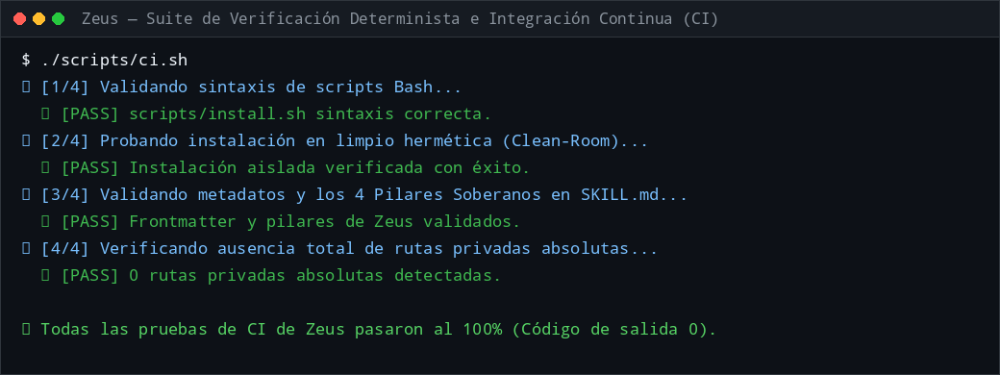

<div align="center">

# ⚡ ZEUS
### Sovereign Task Architecture & Deep Decomposition Protocol
#### Meta-Skill Universal para Claude Code, OpenAI Codex, Google Antigravity, OpenCode & Más


[](LICENSE)
[-blueviolet.svg)](#-compatibilidad-universal-multi-entorno)
[](#-el-protocolo-de-los-4-pilares-soberanos)
[](scripts/ci.sh)

</div>

**Zeus** es la meta-skill suprema y universal de arquitectura y descomposición profunda de tareas para cualquier entorno asistido por Inteligencia Artificial (**Claude Code, OpenAI Codex, Google Antigravity 2.0, OpenCode CLI, Cursor, etc.**).

Rechaza categóricamente la generación de texto superficial, las checklists vacías y la inflación artificial de especificaciones, rigiéndose por el principio inquebrantable: **profundidad soberana por encima de volumen**.

---

## 🌐 Compatibilidad Universal Multi-Entorno

Zeus está diseñado como una especificación agnóstica de infraestructura, permitiendo desplegar su rigor soberano en cualquier arnés de ingeniería:

| Entorno / Plataforma | Integración y Despliegue |
| :--- | :--- |
| **🤖 Google Antigravity (AGY 2.0)** | Integración nativa como Skill en `~/.gemini/config/skills/zeus/`. Activación mediante chat (`modo zeus`, `zeus`, `@zeus`) o invocación por subagentes. |
| **🧠 Claude Code (Anthropic)** | Compatible como skill de CLI o directiva de sistema en `~/.claude/skills/zeus` o inyectado en `CLAUDE.md`. Eleva las capacidades analíticas de Claude. |
| **⚡ OpenCode CLI** | Compatible con ejecución autónoma en terminal con OpenCode CLI (`opencode`) utilizando modelos DeepSeek (V3/R1), Claude 3.7 o GPT-4o. |
| **⚙️ OpenAI Codex / ChatGPT** | Aplicable en System Prompts, Custom GPTs técnicos y APIs con herramientas de terminal y ejecución en sandboxes. |
| **💻 Cursor / VS Code / Windsurf** | Integrable a nivel de repositorio en `.cursorrules`, `.windsurfrules` o `.github/copilot-instructions.md` para imponer estándares de código no negociables. |

---

## 🏛️ El Protocolo de los 4 Pilares Soberanos

Cuando se le somete un objetivo técnico, Zeus responde a las cuatro preguntas cardinales de la ingeniería de élite:

1. **Descubrimiento de Puntos Ciegos (Blindspot Discovery):** ¿Qué exigiría un profesional top 1% (Staff/Principal Engineer) que el usuario no sabe pedir? Identificación de latencias de cola (p99), fugas de recursos, contratos de invariantes y modos de fallo ocultos.
2. **Deconstrucción del Material Crudo (Raw Substrate):** Partir del bytecode binario, ASTs, esquemas canónicos DDL, syscalls y volcados crudos de memoria en vez de capas de abstracción o resúmenes digeridos.
3. **Instrumental Quirúrgico (Surgical Tooling):** Empleo de herramientas de precisión industrial (`perf`, `BPFtrace`, `rizin`, `mutmut`, `Hypothesis`, `Z3`, `mypy --strict`, `craft-anything`).
4. **Oráculo Externo Determinista (Deterministic External Oracle):** Demostración empírica de la verdad técnica a través de suites CI reproducibles en clean-room, pruebas con código de salida `exit 0` y sumas de verificación criptográficas SHA-256.

---

## 🚀 Instalación y Despliegue Rápido

### En Google Antigravity 2.0:
```bash
git clone https://github.com/darwinsin822/zeus.git
cd zeus
./scripts/install.sh
```

### En Claude Code / OpenCode / Otros arneses:
Copia `SKILL.md` en tu directorio de skills o en las instrucciones maestras del proyecto:
```bash
# Para Claude Code:
mkdir -p ~/.claude/skills/zeus && cp SKILL.md ~/.claude/skills/zeus/

# Para OpenCode CLI:
mkdir -p ~/.config/opencode/skills/zeus && cp SKILL.md ~/.config/opencode/skills/zeus/
```

### Ejecutar verificación determinista de la skill:
```bash
./scripts/ci.sh
```

---

## 📂 Estructura del Repositorio

```text
zeus/
├── .ci/
│   └── ci.yml             # Pipeline de integración continua portable
├── assets/
│   ├── zeus.jpg           # Arte oficial en alta resolución
│   └── zeus-execution.png # Evidencia empírica de verificación CI
├── scripts/
│   ├── ci.sh              # Suite de pruebas deterministas herméticas
│   └── install.sh         # Instalador automatizado e idempotente universal
├── LICENSE                # Licencia MIT de código abierto
├── README.md              # Documentación oficial y compatibilidad multi-entorno
└── SKILL.md               # Definición formal de la skill y protocolo soberano
```

---

## 📊 Evidencia de Ejecución en Vivo

A continuación se muestra la evidencia empírica de la ejecución determinista del pipeline de verificación e integridad técnica:

<div align="center">
  
</div>

---

## 📄 Licencia

Distribuido bajo la Licencia MIT. Consulta el archivo `LICENSE` para más información.
